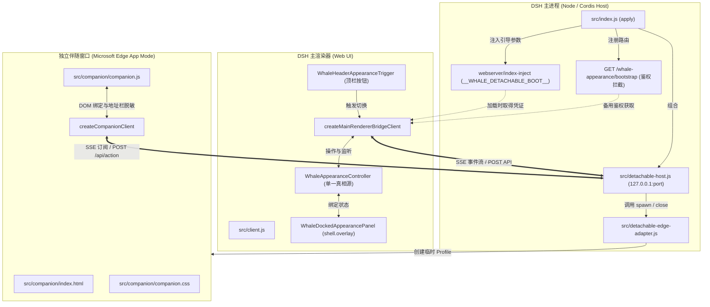

# P1A 正式接入独立/吸附设置窗口链路交付报告

**日期**：2026-10-17\
**开发代号**：小 G (Gemini)\
**复审目标**：Codex / 用户\
**执行基准**：[给小 G 的 P1A 正式接入任务](GEMINI_NEXT_DETACHABLE_APPEARANCE_P1A_20261017.md)、[七审报告](DETACHABLE_APPEARANCE_P0_SEVENTH_REVIEW_20261017.md)与[UI方向设计](DETACHABLE_APPEARANCE_UI_DIRECTION_20261017.md)

---

## 1. 交付概述与范围边界

本轮在离线隔离环境中完成了 **P1A 正式窗口链路接入**，将此前通过七审的通信与会话骨架正式集成进插件的生产生命周期：
1. **正式 Host 服务组合与安全引导**：在 `src/index.js` 中声明式组合可分离 HTTP 服务与受保护引导路由 `/whale-appearance/bootstrap`，通过 Cordis 的 `webserver/index-inject` 机制向主渲染器结构化注入连接引导信息。
2. **生产 Edge 独立窗口适配器**：新增 `src/detachable-edge-adapter.js`，基于已验证的系统标准路径探测 Edge，使用严格参数数组、`shell: false` 与专属隔离临时配置目录启动独立顶层系统窗口，提供确认退出后再清理临时目录的安全销毁流程。
3. **真实静态伴随页与受限静态文件服务**：新增 `src/companion/index.html`、`companion.css`、`companion.js`，并由 `src/detachable-host.js` 提供白名单只读服务（严格限制 GET/HEAD，拒绝路径穿越与编码逃逸，强制 `no-store` 与 `no-referrer`）。页面为纯原生 ESM 架构，零 Node 依赖、零外部 CDN。
4. **单一权威控制器与双视图实时同步**：在主端桥接客户端中接入真实 `WhaleAppearanceController`，通过 `shell.overlay` 提供吸附面板视图，通过独立窗口提供伴随视图。双视图针对**亮度（20–120，默认 70）**与**遮罩（0–90，默认 40）**进行双向即时同步，严格保证无第二控制器、无重复媒体持久化、无回显死循环，并保持过时代次/旧修订版本拒绝机制。

> [!IMPORTANT]
> **边界声明**：本轮任务为 **P1A 链路正式接入阶段**，仅使用亮度与遮罩两个真实字段验证完整链路的连通与双向状态同步；**绝不冒充完整设置 UI 或可视化壁纸库已完成**。可视化壁纸卡片、库与详情布局、跨屏磁吸定位等延后至 P1B 推进；作者专属参数将单独拆分子目标隔离验证。

---

## 2. 架构设计与模块关系



---

## 3. 核心接入点与安全边界核验

### 3.1 Host 组合与引导凭据隔离
- **服务组合**：`src/index.js` 导出精确依赖 `export const inject = ['webServer'];`。在 `apply(ctx)` 中声明式启动 `createDetachableHttpHost`，保证在纯测试隔离环境与真实 Desktop 下均可平稳启动。
- **结构化 Index 注入**：主渲染器页面加载时，通过 `ctx.on('webserver/index-inject')` 注入：
  ```javascript
  table.push({
    kind: 'global',
    name: '__WHALE_DETACHABLE_BOOT__',
    value: { port, mainToken },
  });
  ```
  主渲染器从 `window.__WHALE_DETACHABLE_BOOT__` 直接取得端口与主端通信 Token，无需扫描端口、抓取进程命令行或读取磁盘文件。
- **保护性引导端点**：注册 `/whale-appearance/bootstrap`，严格校验 `ctx.get('connection')?.isAuthenticated(req)`。未鉴权请求一律直接返回 401 Unauthorized；鉴权通过后返回 `{ ok: true, port, mainToken }`，并附加 `Cache-Control: no-store` 与 `Referrer-Policy: no-referrer`。

### 3.2 Edge 窗口适配器安全保障 (`src/detachable-edge-adapter.js`)
- **执行体探测**：严格按照 `findEdgeExecutable` 顺序查找：
  1. `process.env['PROGRAMFILES(X86)']\Microsoft\Edge\Application\msedge.exe`
  2. `process.env.PROGRAMFILES\Microsoft\Edge\Application\msedge.exe`
  3. `process.env.LOCALAPPDATA\Microsoft\Edge\Application\msedge.exe`\
  若不存在，优雅返回 `{ available: false, reason: 'msedge-not-found' }`，禁止自动下载或调用未知浏览器。
- **隔离 Profile**：每个独立窗口均在 `os.tmpdir()` 下创建带唯一 UUID 的专属临时目录 `whale-companion-profile-${randomUUID()}`，与用户日常 Edge 数据物理隔离。
- **启动参数与防逃逸**：使用固定参数数组，严格设置 `shell: false`，杜绝任何 shell 逃逸注入风险：
  ```javascript
  const args = [
    `--app=${appUrl}`,
    `--user-data-dir=${profileDir}`,
    '--no-first-run',
    '--no-default-browser-check',
    '--disable-extensions',
    '--disable-background-networking',
    '--window-size=380,680',
  ];
  ```
- **进程终止与确认机制**：
  1. 优先尝试软终止；
  2. Windows 环境下采用针对具体 PID 的精确树状终结：`taskkill /PID <pid> /T /F`，绝不模糊匹配 `msedge.exe` 进程名或窗口标题；
  3. 轮询确认操作系统确认进程退出后，方才递归清理临时 profile 目录；
  4. 严格校验待删除路径前缀，非本适配器创建的目录一律拒绝删除。

### 3.3 静态伴随页面与通信防逃逸 (`src/companion/` 与 `src/detachable-host.js`)
- **固定白名单清单**：仅提供 `/`、`/index.html`、`/companion.js`、`/companion.css`、`/detachable-contract.js`、`/favicon.ico`。非清单路径一律返回 404。
- **请求动词守卫**：所有静态资源路由仅接受 `GET` 与 `HEAD`，其余动词（`POST`、`PUT`、`DELETE` 等）统一返回 `405 Method Not Allowed`，并在响应头明确标明 `Allow: GET, HEAD`。
- **路径穿越防御**：严格阻断 `..`、`%2e`、`\`、`\0` 及其变体，防止逃逸至代码仓或操作系统任意目录。
- **前端凭证脱敏**：独立窗口打开时，URL 查询串携带一次性握手 token。页面加载瞬间立即执行：
  ```javascript
  window.history.replaceState({}, document.title, window.location.pathname);
  ```
  彻底从地址栏和历史记录中抹去凭证，防止截图与 referrer 泄露。

### 3.4 唯一控制器与双向防循环实时同步
- **单一真相源**：吸附视图与独立伴随窗口共享唯一的 `WhaleAppearanceController` 实例。独立窗口中不运行任何第二份 controller，不执行媒体持久化或重复画布图层逻辑。
- **双向即时同步**：
  - 主端修改亮度/遮罩：Controller 状态变更 -> 主端 Bridge 推送 Snapshot 到 Host -> Host 通过 SSE 推送到伴随窗口 -> 伴随窗口滑动条与输入框同步更新。
  - 伴随端修改亮度/遮罩：伴随窗口发 Action -> Host 经 SSE 转发主端 -> 主端 Controller 应用新值并递增 revision -> 确认结果返回伴随端。
- **回显与重复写入抑制**：当设定值与当前快照一致时，自动阻断冗余更新，持久化计数不发生递增。
- **过时代次与旧修订版本拒绝**：伴随端若携带过期 `expectedRevision`，主端与 Host 均返回 `stale-revision` 错误并同步返回最新快照，确保状态绝不被乱序重试覆盖。

---

## 4. 测试套件与验证证据

### 4.1 全量测试执行汇总表

| 测试命令 | 覆盖模块与测试目标 | 测试项数 | 结果 | 关键特征 |
| :--- | :--- | :--- | :--- | :--- |
| `npm run check` | 全量源码与守卫语法检查（11 个核心文件 + CSS 模板守卫） | 11 文件 | **PASSED** (Exit 0) | 0 语法错误，0 孤立反引号，0 单反斜杠转义 |
| `npm run test:detachable-p0` | P0 全量契约、H1/H2 队列边界、G1/G2/G3 代次与模式回滚 | 15 项 | **PASSED** (Exit 0) | 15/15 全部通过，耗时约 1.27s |
| `npm run test:detachable-e2e` | 真实双 Tab 隔离浏览器端到端流程与生命周期验证 | 11 项 | **PASSED** (Exit 0) | spawn=3, close=3, 零悬挂窗口 |
| `npm run test:detachable-p1a` | P1A 生产接入集成套件（Host引导、Edge适配器、静态Manifest、双视图同步、脱敏） | 5 项 | **PASSED** (Exit 0) | 5/5 全部通过，耗时约 714ms |
| `npm run test:sdk-contract` | 宿主 Cordis SDK 真实契约验证与路由注册 | 完整流程 | **PASSED** (Exit 0) | 注册 `/whale-appearance/bootstrap` 与 `/whale-wallpaper` |
| `npm run test:appearance-selection` | 壁纸与场景选择器回归 | 2 项 | **PASSED** (Exit 0) | 场景切换逻辑正常，无意外启动 |
| `npm run test:appearance` | 鲸系外观全量回归（双主题、颜色、对比度、亮度 120、遮罩等） | 100+ 项 | **PASSED** (Exit 0) | 100+ 项断言全部 PASS |

---

### 4.2 `test:detachable-p1a` 专项运行日志证据

```text
> dsh-whale-mist@0.6.0-rc.30 test:detachable-p1a
> node --test qa/detachable-p1a-production.test.mjs

✔ 1. Host Lifecycle, Index Injection, and Protected Bootstrap Route (105.5591ms)
✔ 2. Edge Window Adapter: Discovery, Sandbox Arguments, Dedicated Profiles, and Orderly Close (13.7686ms)
✔ 3. Static Companion Assets: Manifest Serving, Method Guard, and Traversal Defense (93.8285ms)
✔ 4. Dual Views (Docked Panel & Companion Window) with Single Authoritative Controller (332.3198ms)
✔ 5. Companion Application (companion.js) Token Scrubbing, DOM Sync, and Error Guard (0.7366ms)
ℹ tests 5
ℹ suites 0
ℹ pass 5
ℹ fail 0
ℹ cancelled 0
ℹ skipped 0
ℹ todo 0
ℹ duration_ms 714.5177
```

---

### 4.3 `test:sdk-contract` 运行日志证据

```json
{
  "themeModule": "file:///F:/dsh-wallpaper-plugins/dsh-whale-mist/src/index.js",
  "sdkModule": "file:///C:/Users/HP/AppData/Local/Programs/DeepSeek%20Harness/resources/app.asar/dsh/node_modules/@deepseek-ai/cordis/lib/index.js",
  "isolated": true,
  "declaredInject": [
    "webServer"
  ],
  "hasApply": true,
  "registeredRoutes": [
    "/whale-wallpaper",
    "/whale-appearance/bootstrap"
  ],
  "routesRegistered": true,
  "statusResponse": {
    "status": 200,
    "available": true,
    "reason": ""
  },
  "statusReplyOk": true,
  "startWithUnknownScene": {
    "status": 409,
    "error": "unknown scene: ../../etc/passwd"
  },
  "startRefused": true,
  "unknownModeRefused": true,
  "badModeResponse": {
    "status": 409,
    "error": "unknown mode: forever-more"
  },
  "metricsAccepted": true
}
```

---

## 5. 文件变更清单与依赖说明

### 5.1 生产与契约源文件
1. `src/detachable-edge-adapter.js` (新增)：
   - 生产 Edge 窗口管理适配器；实现进程安全启动、专用临时目录创建、PID 树状销毁与退出后清理。
2. `src/companion/index.html` (新增)：
   - 独立伴随窗口结构；包含状态药丸、亮度/遮罩滑动与数字输入、吸附与关闭操作区。
3. `src/companion/companion.css` (新增)：
   - 伴随窗口独立样式表；无外链字体或 CDN，原生适配鲸渊/鲸雾调色板。
4. `src/companion/companion.js` (新增)：
   - 伴随窗口客户端控制层；实现地址栏脱敏、双向快照绑定、动作调度与异常横幅展示。
5. `src/detachable-contract.js` (更新)：
   - 增强 `createCompanionClient` 的结构化状态分发（通知 `{ connected, snapshot, revision, settings, brightness, mask }`），并提供 `setSetting(key, value)` 和 `dispatchAction(action)` 便捷调用方法。
6. `src/detachable-host.js` (更新)：
   - 增加固定清单静态文件服务（支持 GET/HEAD，拦截非法动词 405，阻断目录穿越 400/404）；
   - 挂载安全响应头；
   - 默认窗口适配器保持 `null`，仅在生产或显式指定时启用 Edge 适配器，保护无 Edge 环境下的单元测试。
7. `src/index.js` (更新)：
   - 组合 `createDetachableHttpHost`，在 `apply(ctx)` 中声明并启动；
   - 挂载 `webserver/index-inject` 注入 `__WHALE_DETACHABLE_BOOT__`；
   - 注册受保护路由 `/whale-appearance/bootstrap`；
   - 完善 dispose 清理生命周期。
8. `src/client.js` (更新)：
   - 嵌入合约动作调度与桥接客户端逻辑；
   - 注册 `conversation.session.header.actions` 顶栏触发器 (`WhaleHeaderAppearanceTrigger`)；
   - 注册 `shell.overlay` 吸附面板 (`WhaleDockedAppearancePanel`)。

### 5.2 测试文件与包配置
1. `qa/detachable-p1a-production.test.mjs` (新增)：
   - 包含 5 项针对生产接入要求的隔离测试（Host 生命周期、Edge 适配器、静态资源与安全头、双端双向实时同步、前端 DOM 交互与凭据脱敏）。
2. `package.json` (更新)：
   - scripts 增加 `"test:detachable-p1a": "node --test qa/detachable-p1a-production.test.mjs"`；
   - `check` 检查列表与 `files` 打包列表增加新模块。

---

## 6. 未覆盖项与后续规划 (P1B)

1. **未覆盖项与实机约定**：
   - 本轮全部测试均在离线隔离测试桩与 Headless 浏览器中完成；未创建可见的操作系统顶层窗口，未向运行中的 DSH 0.2.1-rc.2 发起修改。
   - 跨显示器自动记忆、平滑吸附过渡动画、磁吸拖拽感应属于桌面 UI 增强体验，不包含在 P1A 链路验收中。
2. **下一步工作 (P1B)**：
   - 整理共享控件规范，将亮度、遮罩、底色、强调色等字段整合成统一的双视图组件库；
   - 构建可视化壁纸卡片、库与详情页布局（依据 [UI 方向设计](DETACHABLE_APPEARANCE_UI_DIRECTION_20261017.md)）；
   - 壁纸作者专属参数另拆目标独立验证，坚决不与通用外观设置混淆。
