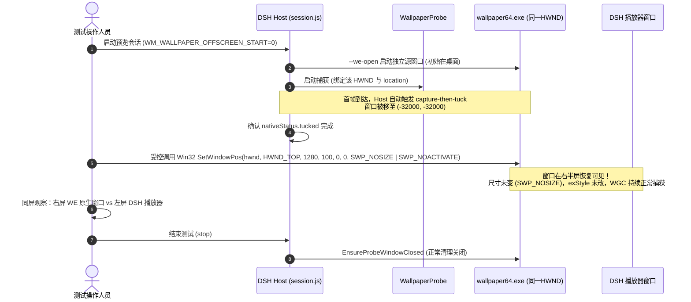

# 三体独立源实例品质、演算参数与进入 DSH 变速最小区分调查报告 (根据 Codex 复审收敛修订)

日期：2026-10-16
调查执行：Gemini (Flash)
对应任务书：[GEMINI_NEXT_MOTION_CADENCE_INGRESS_20261016.md](GEMINI_NEXT_MOTION_CADENCE_INGRESS_20261016.md)
前序观察：[场景差异补充](MOTION_CADENCE_SCENE_SPECIFIC_OBSERVATION_20261016.md)
Codex 复审意见：[三体源实例调查复审](MOTION_CADENCE_SOURCE_INSTANCE_REVIEW_20261016.md)
实测数据参考：[rc.32 实测记录](RC32_MOTION_CADENCE_SHORT_TEST_20261016.md)
封板交付基准：[MOTION_CADENCE_TRACE_DELIVERY_20261015.md](MOTION_CADENCE_TRACE_DELIVERY_20261015.md)

---

## 1. 调查概述与工作边界

依据任务书与 Codex 复审意见，本轮调查聚焦于用户提出的最新关键视觉观察——**“三体背景移动平滑，没有突然加减速；其它动态壁纸（如麻匪作品）的水流也平滑，明显突变主要在三体球体”**。

调查严格遵循以下边界：
1. **只读核查**：只读取本机项目元数据、用户 Wallpaper Engine 全局配置文件快照、官方文档及仓库已有启动源码；
2. **严守非侵入原则**：**未修改任何生产代码或 QA 测试脚本**，**未提升采集 FPS**，**未修改 P4 等待或调度**，**未扩写日志**，**未操作 DSH 或 WE 运行实例**，**未改变工作区 rc.30 版本及 12 项运行资产**；
3. **收敛运行结论与对照方案**：落实 Codex 复审提出的 R1（运行证据边界）、R2（可执行保持可见方案）与 R3（有条件判定及观察副作用），供 Codex 再次独立复核。

---

## 2. 已核实事实与配置证据边界 (R1 收敛)

### 2.1 本机三体壁纸项目属性与作者演算设定

- **项目文件**：`E:\SteamLibrary\steamapps\workshop\content\431960\3509243656\project.json`
- **标题**：“三体实时演算 | Three-Body problem - SYKM”，`type = "scene"`，SHA256: `982EF336280C59023731A34C6D64A49B4BF0A54C344FF62321410CCF5A31930D`
- **作者算法描述与元数据**：
  - 声明采用 **4 阶辛积分器（Yoshida 1990）** 进行轨道数值解算；
  - 声明在天体近距离处采用 **Aarseth 分段线性软化** 处理，以避免引力奇点；
  - 天体初态：元数据默认随机种子模式（`customcivenabled.value == false`，且定义了 `Random Pos Range = 2`、`Random Speed Range = 0.1`），具体初始化逻辑以脚本实际解算为准；
  - 作者在 v3.8.0/v3.8.1 更新说明中注明：“重写了时间倍速功能，尽量在不同设备上保持物理一致性(但很难)”。
- **作者使用条件与硬件提示**：
  - `bigfontcolorffbbbbbr60` 字段明确标红警告：
    `!!!此壁纸需设置超高品质，帧率大于60`
    `!!! NOTE: This wallpaper must be set to Ultra High Quality`
  - 这是作者的使用建议与配置提示，不代表引擎强制约束或已被证实的故障因果。
- **演算参数默认参考值**：
  - `newproperty53`（计算步长 Step Size ms）：默认 **`0.75`**（范围 0.01..10）；
  - `timespeed`（时间倍速 time speed）：默认 **`1.0`**（范围 0.1..3）；
  - `_110` 恒星质量：默认 `5000000`；`_111lum_sun` 恒星光度：默认 `1.5` / `0.5`。

### 2.2 用户 Wallpaper Engine 全局配置与壁纸属性覆盖

- **配置文件**：`E:\SteamLibrary\steamapps\common\wallpaper_engine\config.json`
- **当前用户 Profile (`HP`) 的全局性能与图形预设（磁盘快照）**：
  - `preset`: **`"ultra"`**；
  - `fps`: **`180`**（用户全局配置的目标上限帧率为 180 fps）；
  - `msaa`: `"x2"`；`postprocessing`: `"ultra"`；`shadows`: `"ultra"`；`resolution`: `"full"`；
  - `playbackfocus`: `"run"`（失焦不暂停）；
  - `playbackmaximized`: `"pause"`；`playbackfullscreen`: `"pause"`。
- **用户对该三体壁纸的个性化覆盖（`wproperties`）**：
  - `cfg['HP'].wproperties['.../3509243656/scene.pkg']` 磁盘项仅见：
    `"Monitor1": { "volume": 18 }`, `"MonitorPositionL0T0": { "volume": 29 }`
- **边界核实（R1）**：
  - 磁盘全局目标为 ultra/180，该目标项目的指定 `wproperties` 项仅见音量；
  - **`fps: 180` 是磁盘配置目标上限，不是独立窗口实际渲染或 SceneScript 运行达到 180fps 的测量**；
  - 该 `wproperties` 项未见步长/倍速覆盖，不足以证明运行内存、脚本初始化或独立 location 的最终参数必然等于默认值，默认 0.75ms 步长与 1.0 倍速仅作为**候选参考值**。

### 2.3 仓库独立源实例启动命令与继承机制

- **启动入口**：`dsh-whale-mist/qa/wallpaper-probe/SourceWindowHelper.cs:303-322`
  `openWallpaper -file "<project.json>" -playInWindow "<location>" -width <w> -height <h> [-x <x> -y <y> -borderless]`
- **继承机制与概念辨析（R1）**：
  - 官方 CLI 中的 `-preset` 参数表示用户保存的**本地壁纸预设名称**（Local Wallpaper Preset Name），不能与全局图形预设 `HP.general.user.preset=ultra` 混为一谈；
  - 启动命令未显式传递 `-preset`，也未传递 `-properties`；未显式指定并不等于已证明全部运行语义的继承细节；
  - 源实例实际渲染 FPS 与演算更新周期仍待测量确认；DSH `WallpaperProbe` 以固定目标 `fps = 30`（WGC 周期 ~33.3ms）进行屏幕捕获，与源渲染存在采样差异。

---

## 3. 仍未知的事实与分析边界 (P3 措辞修正)

1. **源窗口屏外（`x=4096+`）实际渲染与物理更新帧率未知**：
   - 当独立窗口位于屏幕外或后台时，Windows DWM 及 Wallpaper Engine 引擎是否对不可见窗口进行了垂直同步解耦、渲染节流或时间步长补偿？目前缺乏独立源窗口在屏外时的真实 FPS 与 frametime 测量；
2. **SceneScript 内部物理循环实现细节未知**：
   - 资源封装在 `scene.pkg` 内，本轮未解包，无法确认其辛积分器是严格按 `engine.frametime` 累加连续物理时间，还是采用固定子步迭代；
3. **天体物理非线性运动与视觉感知的耦合未知**：
   - 三体运动在近距离存在自然非匀速运动可能（即使有 Aarseth 软化处理）；但是否能解释用户感知到的突发加减速，目前缺乏量化速度轨迹；
4. **DSH 接收节奏波动与球体突变的因果关系未知**：
   - rc.32 实测中记录的 seq 423→424 的 569.1ms accept 间隔及 191 个同时间戳重复键，证明在特定条件下 Host 到客户端存在接收节奏波动；但由于快速运动的球体比低速漂移的背景对抽样间隔更敏感，尚不能直接定论 569ms 波动是球体突变的唯一主因。

---

## 4. 区分“源实例自身”与“DSH 管道”的同源对照方案 (R2/R3 收敛)

### 4.1 核心思路与必须解决的执行问题 (R2)

同源对照的核心是：**在同一个物理初态和同一运行周期下，对“同一个由 Host 绑定的独立源窗口”进行裸窗口肉眼观察与 DSH 播放画面对比。**

但 Codex 复审通过合成控制指出了关键事实（`session.js:578-599`）：
- 无论 `offscreenStart` 是 true 还是 false，只要窗口不在屏外（`visibleArea !== 0`），首帧采集后 Host 的 `onChildStderr` **仍会无条件执行 `capture-then-tuck`**，调用 `helper(['--window-apply', hwnd, 'offscreen', ...])` 将其移到 `(-32000, -32000)`；
- 现有的 `--window-apply onscreen` 动作会强制设置 `(100, 100)`、重设大小为 `1280x720` 并修改 `exStyle`，会破坏当前捕获尺寸和样式；
- 同一 `wallpaper64.exe` 进程可承载多个窗口，必须严格核对 Host 本轮绑定的同一 `HWND` 与 `location`。

### 4.2 可执行同源可见方案 (R2 可行步骤)

为保证方案具有实际可操作性，同时避免修改生产代码与破坏捕获参数，提出**外部受控位置恢复方案（方案 A）**与**最小诊断代码提案（方案 B）**：

#### 方案 A：外部受控位置恢复（0 行生产代码改动，首选）

- **执行前准备与绑定验证**：
  1. 通过 Host 状态接口或 `preview-status.json` 读取当前会话的 `windowReady: { hwnd, pid }` 与 `location`；
  2. 使用 `SourceWindowHelper.VerifyExpectedWindow(hwnd, location, pid)` 确认该 HWND 仍归属本轮 `wallpaper64.exe` 及本轮 `location`，绝不混淆或操作其他窗口；
- **时序与恢复可见操作**：
  1. 会话启动时设置 `WM_WALLPAPER_OFFSCREEN_START=0`；
  2. 启动后等待约 1 秒，确认首个 status 帧到达且 Host 完成 `capture-then-tuck`（此时 `nativeStatus.tucked` 已记录）；
  3. 通过受控脚本调用 Win32 `SetWindowPos(hwnd, HWND_TOP, targetX, targetY, 0, 0, SWP_NOSIZE | SWP_NOACTIVATE)`：
     - 将该同一 HWND 移动到屏幕可见区域（如主屏幕右半侧 `x=1280, y=100`）；
     - **严格携带 `SWP_NOSIZE`**：绝不改变窗口宽度与高度，保证 WGC 帧池尺寸不发生突变；
     - **不修改 `GWL_EXSTYLE`**：保持原有窗口样式，避免触发 WGC 重建失败；
- **清理与恢复**：
  - 测试观察完成后，正常通过 DSH 发送 `/whale-wallpaper/stop`；
  - Host 的 `EnsureProbeWindowClosed(location)` 本来就会根据 location 干净关闭该窗口，窗口在屏幕内或屏幕外均能被证明关闭，清理流程完全不受影响。

#### 方案 B：Host 最小诊断开关提案（备选，需修改 2 行源码供复核）
若希望完全避免“移出又移回”的一瞬间闪烁，可在 `session.js:583` 的 tuck 分支引入临时诊断环境变量：
`if (process.env.WM_WALLPAPER_DISABLE_TUCK === '1') return { ...source, strategy: 'disabled-tuck' };`
当该变量显式启用且 `offscreenStart=false` 时，Host 直接跳过 `helper(args)` 屏外移动。**该方案当前仅作为提案记录，未获批准前不修改生产源码。**

---

### 4.3 观察方法与有条件判定准则 (R3)

#### 1. 对应运动片段对齐（非同瞬间比对）
由于 WGC 捕获、管道编码、HTTP 传输及客户端主线程绘制存在端到端延迟（~30-100ms），观察者**不应比对绝对墙钟时间同一瞬间**，而应**跟踪同一个天体在经过特定轨道段（如近星飞掠点、轨道拐角或远星漂移段）时的运动形态**。

#### 2. 多分支有条件判定准则 (R3)

| 观察现象 | 倾向性判定与下一步排查范围 | 注意事项与不能下的结论 |
| :--- | :--- | :--- |
| **现象 1：两边均明显突变** | **倾向于源端已有显著贡献**：三体物理模拟本身的近星加速飞掠，或 SceneScript 步长累加逻辑存在不均匀性。 | **不能排除传输问题**：不能排除 DSH 在源端波动之上叠加了额外的网络/主线程抖动。 |
| **现象 2：源窗口平滑，而 DSH 呈现显著突变** | **倾向于失真发生在源输出之后的链路**：重点排查 WGC 30fps 采样混叠、latest 帧覆盖策略、HTTP 分片或客户端主线程绘制。 | **不能宣布已定位单一 bug**：不等于已确定某个具体代码错误，且不能完全排除源渲染与 WGC 抓取的交互效应。 |
| **现象 3：两边均有突变但程度不一 / 无法稳定复现 / 未对齐** | **判定为混合或未知**：需进一步记录具体轨道事件，不能强行归因于单一侧。 | 保持未知，不预先修改调度或重构架构。 |

#### 3. 观察副作用与条件变化说明 (R3)
将源窗口放置在屏幕可见区域并排显示，存在以下客观观察副作用：
1. **可见性与 DWM 负载**：源窗口在屏内需要由 DWM 参与桌面合成与双重渲染，GPU 资源竞争与排队不同于完全离屏（`x=4096+`）环境；
2. **焦点与全局规则干扰**：用户 WE 全局配置了 `playbackmaximized: pause` 与 `playbackfullscreen: pause`；测试时**必须保持 DSH 播放器和源窗口均为普通窗口化平铺**，禁止最大化或全屏，防止意外触发 WE 引擎暂停；
3. **外推局限**：同屏直视结果主要用于定性缩小排查范围，**不能直接等同于历史屏外条件的运行数据**。

---

## 5. 总结与后续状态

1. **已收敛结论**：
   - 磁盘配置目标 180fps 与项目默认 0.75ms 步长为候选参考，源实例运行帧率与实际参数仍待实测；
   - 提出了兼顾 Host 绑定 HWND 身份、防尺寸样式破坏的可执行外部受控方案（方案 A）及诊断开关提案（方案 B）；
   - 判定准则已收敛为多分支有条件倾向性判断，如实陈述了同屏显示的观察副作用。
2. **移交状态**：
   - 本修订报告已同步归档，移交 Codex 再次独立复核；
   - **当前不修改生产/QA 代码、不准备候选、不进入实机测试**。
