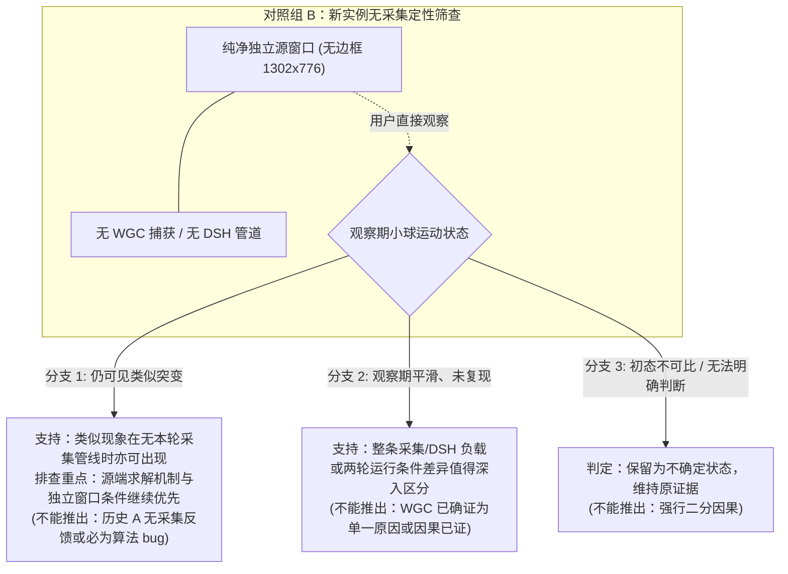
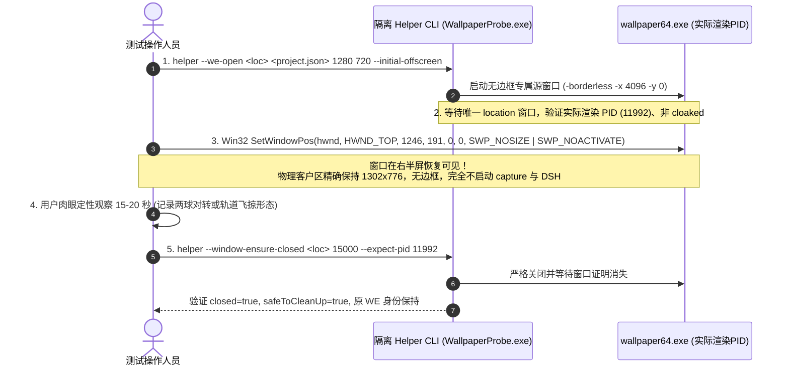

# 同源对照后的源端运行条件窄调查与无采集定性筛查提案 (根据 Codex 复审修订)

日期：2026-10-16
调查执行：Gemini (Flash)
对应任务书：[GEMINI_NEXT_SOURCE_SIDE_AFTER_SAME_SOURCE_20261016.md](GEMINI_NEXT_SOURCE_SIDE_AFTER_SAME_SOURCE_20261016.md)
Codex 复审意见：[源端窄调查复审](MOTION_CADENCE_SOURCE_SIDE_REVIEW_20261016.md)
输入证据基准：[同源短对照实测结果](MOTION_CADENCE_SAME_SOURCE_RESULT_20261016.md)、[源实例调查及二审](MOTION_CADENCE_SOURCE_INSTANCE_SECOND_REVIEW_20261016.md)、[rc.32 实测](RC32_MOTION_CADENCE_SHORT_TEST_20261016.md)

---

## 1. 调查背景与新事实前提

根据 Codex 实施的同源短对照实测（`MOTION_CADENCE_SAME_SOURCE_RESULT_20261016.md`），在将 DSH 绑定的专属源窗口移入桌面可见区域后，用户直接观察确认：
> **“右侧源也会突变，左侧也会”。**

同时，用户最新补充了关键观察：
> **“即使两球处于预期稳定对转的状态，也出现忽快忽慢”。**

### 确立的前提与排查重心转移
1. **球体突变在被采集的专属源窗口内已经肉眼可见**：
   - 彻底打破了“源端平滑、仅下游传输与播放故障”的前提；
   - 用户关于“两球稳定对转也忽快忽慢”的反馈，表明现象不能仅简单用“近星点开普勒极端飞掠”或主观心理阈值解释，必须严肃排查源端求解步长累加逻辑或运行负载干扰；
2. **已有下游证据仍然保留**：
   - 专属源窗口可见突变，并不证明下游传输和客户端完全无责；此前 rc.32 记录的 569.1ms 同 seq 接收间隔以及 191 个诊断重复事件依然是客观记录的接缝现象，可能在源端波动的基础上产生了叠加或放大；
3. **保持原 WE 实例与身份严肃性**：
   - 原 WE 进程与专属源窗口的 PID 均为 `11992`，专属源是同一 `wallpaper64.exe` 进程内由 DSH 命令行创建的独立 `location` / `HWND`，**并非另起独立的 WE 进程**。

---

## 2. 源码与现有证据差异表：桌面壁纸 vs DSH 专属源窗口

通过核查 `dsh-whale-mist/qa/wallpaper-probe/SourceWindowHelper.cs`、`dsh-whale-mist/src/wallpaper/session.js`、用户 WE `config.json` 磁盘快照及项目 `project.json`，两者的差异矩阵如下：

| 对比维度 | 桌面壁纸实例 (Desktop WorkerW) | DSH 专属源窗口 (PlayInWindow HWND) | 差异性质与证据路径 |
| :--- | :--- | :--- | :--- |
| **创建与绑定命令** | WE 随系统自启，依配置绑定桌面 `WorkerW` / `Progman`（常见系统背景，具体层级与优先级待测） | 由 DSH 通过命令行动态打开： `wallpaper64.exe -control openWallpaper -file "<pkg>" -playInWindow "<location>" -width <w> -height <h> [-borderless]` | **已知源码行为**： DSH 专属窗口通过 `-playInWindow` 运行，带有独立的 location 标题与专属 HWND。 路径：[`SourceWindowHelper.cs:310`](../dsh-whale-mist/qa/wallpaper-probe/SourceWindowHelper.cs#L310) |
| **图形品质预设 (Preset)** | 绑定显示器配置，使用全局 `preset: ultra` | 启动命令**未显式传递 `-preset <name>`**，理论继承 WE 引擎未指定预设时的默认行为 | **磁盘配置已知，运行值待确认**： 全局快照为 `ultra`，但官方 CLI `-preset` 指壁纸本地预设名称，非全局图形字段。 路径：`config.json: HP.general.user.preset` |
| **有效目标 FPS** | 全局配置目标上限 `fps: 180` | 全局配置目标上限 `fps: 180`；DSH 采集端以 `fps: 30` 进行 WGC 抓取 | **配置上限已知，实际源帧率未知**： 180fps 仅为目标上限，两者的实际内部渲染 FPS 与每帧时间 `engine.frametime` 均未有运行时测量。 |
| **物理窗口外框与视口** | 铺满桌面全屏（待实测） | 本轮物理外框移动前 `[4096,0,5398,776]`，移后 `[1246,191,2548,967]`；物理客户区与 capture 均为 1302×776 | **已知确切物理尺寸**： 专属窗口物理客户区为 1302×776（旧 868×517 读数为 DPI 虚拟化读数）。 路径：`plan3.json / move.json` |
| **窗口位置与可见性** | 始终位于桌面最底层，全屏可见 | 正常运行位于屏外 `[4096, 0]`；同源测试时受控移至屏内可见区域 | **已知运行时状态**： 屏外与屏内涉及完全不同的 DWM 合成路径与可见性规则。 |
| **后台/焦点与暂停规则** | `playbackfocus: run` `playbackmaximized: pause` `playbackfullscreen: pause` | 作为独立顶层窗口，理论上受相同全局规则制约（实际运行时是否触发待测） | **待证继承推测**： 磁盘快照仅证实指定 `wproperties` 仅有音量，不代表全局任何覆盖均不存在；若窗口全屏/最大化可能触发 WE 暂停。 |
| **个性化属性 (wproperties)** | `cfg.wproperties['.../scene.pkg']` 磁盘项仅见音量设置 | 启动未传 `-properties`，读取同一路径配置 | **已知磁盘未覆盖**： 磁盘未持久化任何自定义步长/倍速，默认 0.75ms 步长与 1.0 倍速为候选参考。 |
| **外部采集管线负荷** | **无**（除系统常规 DWM 合成外，无独占外部进程抓取纹理） | **有**（`WallpaperProbe` 进程以 30fps 持续从 surface 拷贝资源到 staging 纹理、CPU 编码与管道传输） | **已知客观存在**： 专属窗口承受独占的 WGC 捕获管线负荷，可能间接产生 GPU/CPU 资源争用，但无持续独占锁定源表面的证据。 |

---

## 3. 按区分力排序的四项核心假设

基于“专属源窗口亦有突变”以及“两球稳定对转也忽快忽慢”的新证据，将现有假说按**排查优先级与区分力**排序：

### 假设 1：源端演算逻辑与时间推进特性（排查优先级：最高）
- **核心论点**：突变源自三体物理求解机制或 SceneScript 积分器在特定条件下的表现。
  - 用户反馈“两球稳定对转也忽快忽慢”，表明不能仅归因于单次极速飞掠，而更指向**积分器步长累加逻辑对变动帧时间的响应机制**（如作者在更新说明中所述“重写了时间倍速...尽量保持物理一致性但很难”）；
  - 当帧渲染时间（frametime）发生细微波动时，若步长累加离散化处理不够平滑，可能导致模拟推进速率剧变。
- **支持证据**：专属源窗口自身直接可见加减速；用户此前观察到背景与水流平滑，突变集中于天体对象。
- **未知与反证**：用户曾反映桌面壁纸三体球体相对平滑；`scene.pkg` 尚未解包，求解代码细节未审计。
- **能区分的观察**：在**脱离 DSH 会话、无 WGC 捕获管线**的纯净独立源窗口中，观察小球在同等轨道段是否依然存在类似加减速。

### 假设 2：WGC 采集管线与系统负载对源端的间接反馈（排查优先级：高）
- **核心论点**：`WallpaperProbe` 对专属源窗口的 30fps WGC 捕获、D3D11 拷贝、等待与 CPU 编码，间接占用了 GPU/CPU 资源，扰乱了 `wallpaper64.exe` 的渲染节奏。
- **支持证据**：桌面壁纸未受 WGC 独占抓取管线消耗；专属源窗口在被捕获时，WGC 表面拷贝与管线调度可能导致源渲染帧时间突刺。
- **未知与反证**：Windows WGC 基于合成表面共享，开销通常受控；`StagingReadback` 仅在帧到达时 CopyResource 并 Map/Unmap，**不存在持续排他性锁死源渲染表面的源码证据**，尚无本轮因果测量。
- **能区分的观察**：对比有采集管线运行 vs 无采集管线运行状态下，源窗口中球体运动的定性表现差异。

### 假设 3：专属源窗口条件与桌面壁纸的系统级差异（排查优先级：中）
- **核心论点**：WE 引擎对 `-playInWindow` 独立窗口与桌面 `WorkerW` 底层壁纸采用了不同的调度策略（例如：DWM 刷新率、后台渲染降频、GPU 优先级分配）。
- **支持证据**：两者窗口层级、类名、样式及尺寸完全不同。
- **未知与反证**：WE 官方文档未声明独立窗口存在内部强制降频；用户 WE 全局已配置 `playbackfocus: run`。
- **能区分的观察**：同一物理环境下，独立窗口化运行与全屏桌面运行的实际渲染 FPS 与 frametime 监测对比。

### 假设 4：下游传输、采样与显示波动（排查优先级：补充/叠加层）
- **核心论点**：不能作为专属源窗口突变的唯一起因，但作为叠加放大因素依然存在。
- **支持证据**：rc.32 记录的 569.1ms 同 seq 接收间隔及 191 个诊断重复事件；30fps 离散采样对高速移动球体的频闪效应（Aliasing）。
- **局限**：已被同源对照证实无法解释“源窗口本身可见突变”。

---

## 4. 最小单变量对照提案：新实例无采集定性筛查 (R1/R2/R3 落实)

### 4.1 生命周期限制与不可行路径澄清 (R3)

任务书提出优先考虑：“同一专属源窗口在‘采集运行/不采集’条件下的直接运动差异”。

经过对生产源码的走查，**严格证明现有日常停止路径不支持直接在同一专属源窗口上“停掉采集而保留源窗口”**：
1. **日常停止路径必然进入清理**：
   [`session.js:550-558`](../dsh-whale-mist/src/wallpaper/session.js#L550-L558) 规定子进程正常或受控退出时触发 `stop()`，进而调用 `runClose()` 执行 `--window-ensure-closed <location>`；
2. **Probe 退出时的所有权回收**：
   [`Program.cs:345-359`](../dsh-whale-mist/qa/wallpaper-probe/Program.cs#L345-L359) 规定当父管道断开且满足 `CanCloseOwned` 授权时，Probe 会在退出时调用 `EnsureProbeWindowClosed(ownedLocation)` 关闭窗口；
3. **强杀不能制造合法控制组**：
   强制杀死子进程不仅操作系统不保证执行 finally，而且在 `session.js:320-373` 中会被判定为 `worker-unconfirmed` 并导致清理失败，留下不可控的异常残留窗口。

**结论**：**系统没有公开的“WGC 暂停/停采留源”接口，不能靠强杀制造控制组。**

---

### 4.2 首选方案：新实例无采集定性筛查方案 (R1 & R2)

既然无法在同一次物理运行中动态开闭采集，最有区分力且完全符合保护边界的方案是：**通过受信任的 helper 启动一个同参数、无边框、平铺可见的“纯净独立源窗口”（完全不启动采集进程、不启动 DSH 会话），进行肉眼定性筛查。**

#### 1. 方案定位与三分支判定准则 (R1)
本方案是对照组 B（无采集纯净实例）与历史组 A（有采集同源实测）的**定性筛查**，而非严格单变量因果确证（两组在初态、启动时间、系统负载上存在客观差异）。观察结论收敛为三分支：

| 对照组 B 观察现象 | 可支持的范围 | 不能推出的结论 (防绝对化) |
| :--- | :--- | :--- |
| **分支 1：确认无捕获/无 DSH 会话，仍可见类似突变** | 类似加减速突变在未启动本轮采集管线时亦可出现；源场景演算与独立窗口条件继续优先排查。 | **不能推出**历史 A 没有采集反馈或下游叠加；**不能推出**必是三体物理算法 bug。 |
| **分支 2：观察期平滑、未复现** | 整条采集管线负载、DSH 调度或两轮运行条件的差异值得继续深入区分。 | **不能推出** WGC 已被确证为单一原因；短暂未复现不能直接当作充分因果证据。 |
| **分支 3：不同初态/事件不可比、无法明确判断** | 本轮结果判定为不确定，完整保留原证据。 | **不能推出**强行二分结论；严禁重复长测凑结果。 |

---

#### 2. 可执行启动、验证与恢复流程 (R2)

为避免原报告示例中“缺少 borderless 导致边框视口不一致”以及“`--we-close` 不等待窗口消失”的设计遗漏，给出明确可执行的规范步骤：

1. **环境基准准备**：
   - 确认当前日常 `rc.28` 正常停止，DSH 与 capture/worker 均为 0；记录当前原 WE 实际承载进程 PID（如 `11992`）；
2. **精确复现无边框窗口条件启动（R2）**：
   - 生成当轮唯一 `location`（如 `WhaleWallpaperProbe-clean-261016-<hash>`）；
   - 使用受信赖的 helper 工具调用：
     `helper(['--we-open', location, projectFile, '1280', '720', '--initial-offscreen'])`
     **必须携带 `--initial-offscreen`**：依据 `SourceWindowHelper.cs:319`，只有在指定初始位置时才会传递 `-borderless`，从而生成无系统边框的纯净客户区，避免普通窗口标题栏破坏有效视口；
3. **真实渲染 PID 与窗口身份核对（R2）**：
   - 忽略 `openWallpaper` 返回的 launcher PID；
   - 调用 `SourceWindowHelper.RequireUniqueProbeWindow(location, 5000)` 等待窗口就绪，核对 `hwnd`、实际承载进程路径、PID（`11992`）、启动时间、非最小化且 `cloaked === false`；
   - 读回并记录物理外框、客户区、style、exStyle 以及工作区 DPI；
4. **位置平铺与运行模式澄清（R2）**：
   - 通过 Win32 `SetWindowPos(hwnd, HWND_TOP, 1246, 191, 0, 0, SWP_NOSIZE | SWP_NOACTIVATE)` 将该窗口移动至与本轮同源实测相同的平铺可见位置；
   - **严格携带 `SWP_NOSIZE`**，保证物理客户区精确保持为 1302×776；
   - **运行模式严格明确**：仅使用 helper 执行短暂的单次控制命令，**完全不启动 WallpaperProbe 的 capture pipe 采集模式，完全不启动 DSH Host 会话**（此时系统不存在任何外部 WGC 抓取进程）；
5. **肉眼定性观察与条件约束**：
   - 用户肉眼观察该窗口 15~20 秒，重点观察两球对转或天体轨道交会时的加减速特征；
   - 必须保持该窗口为普通浮动窗口化，严禁最大化或全屏，防止触发 WE 全局的 `playbackmaximized/fullscreen: pause`；
6. **真实验证关闭与恢复（R2）**：
   - 废除仅发异步命令的 `--we-close`，调用真实验证入口：
     `helper(['--window-ensure-closed', location, '15000', '--expect-pid', String(actualRenderPid)])`
   - 严格读取并验证返回的 `closed === true`、`safeToCleanUp === true` 与 `outcome === 'closed'`；
   - 进一步核查系统中该 location / HWND 已彻底不存在，原 WE 进程（PID 11992）存活且启动身份保持。

---

## 5. 调查结论与后续状态

1. **当前状态明确**：
   - **当前没有确认任何生产代码缺陷，没有任何待实现的生产修复**；
   - 方案已补齐 R1（三分支定性筛查防确证）、R2（无边框启动、实际 PID 核查与 `--window-ensure-closed` 验证关闭）与 R3（生命周期与 D3D11 表面机制修正）；
2. **移交与复核**：
   - 本修订报告已完成，移交 Codex 独立复核；
   - **本轮不进行任何实机操作、不改动生产/QA 代码、不准备新包**。
