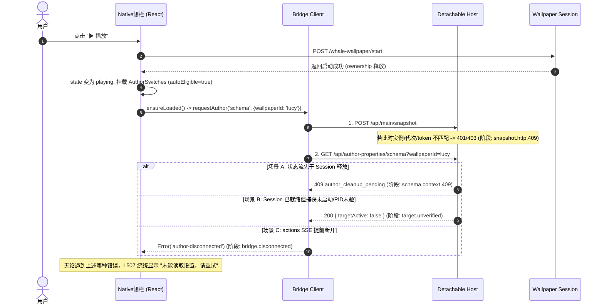

# rc.50 作者参数首次读取定位与复核交付报告

2026-10-26。本报告依据 `docs/RC50_AUTHOR_INITIAL_READ_GEMINI_TASK_20261026.md` 的明确授权与要求编写，完成对 rc.50 实机短验中“Lucy 播放后作者参数首次读取失败（显示『未能读取设置，请重试』）”的独立调用链复核与离线验证。

**核心结论：**
1. **测试缺口与复核结论采纳**：独立核验 Codex 的 6 项真实门禁检查全部成立。证实此前 A（启动持锁）与 B（冷库未刷新）为可在离线构造的真实故障边界，但不足以作为本次已翻页 23 张图库后现场的已定唯一样本；
2. **现场首个失败阶段定案状态**：在生产 rc.50 未保留网络响应、且错误信息全部被一刀切压成同一句中文的情况下，**尚不能在离线排除其它阶段直接断言现场首个失败阶段**。依据“证据不足则交付诊断，不假称已修复”的工程原则，**本轮明确判定为『现场根因未定，交付诊断方案与经过验证的隔离副本』**，不凭空修改生产源码。
3. **两阶段架构方案论证**：已通过可重复反例证实，绝不能仅删 `targetActive` 检查（否则会导致 `canEdit=true` 并产生非法 draft），必须严格实施“只读展示”与“编辑下发”的两阶段状态与代次分离。

---

## 一、已证实、已排除与尚未证实

| 类别 | 项目 | 结论与证据 |
| --- | --- | --- |
| **已证实** | 1. 真实冷库 409 | `library.getAuthorMetadata('lucy')` 在 `snapshot === null` 时抛出 `author_library_unavailable`，Host 返回 HTTP 409。 |
| **已证实** | 2. 启动持锁 busy 先拒绝 | 若请求到达时 `wallpaper.ownership()` 持锁，Host 的 `context()` 检查首先断言 `lifecycle.busy`，直接抛出 `author_cleanup_pending`（HTTP 409），早于 `canApply`。 |
| **已证实** | 3. 目标未就绪阻断 | 若 `lifecycle.busy === false` 但目标尚未验证（`captureStarted: false` 或 `startUtc` 异步中），Host 返回 200 且 `targetActive: false`；客户端 L548 抛出 `target-unavailable`。 |
| **已证实** | 4. 错误文案归一化吞没 | 客户端 L507 的统一 catch 将 `target-unavailable`、`author_cleanup_pending` (409)、`author_library_unavailable` (409)、`bridge.disconnected` 等统统转化为 `"未能读取设置，请重试"`。 |
| **已证实** | 5. 单行删除的破门禁反例 | 若仅移除 L548 检查，读取返回 ready 后 `canEdit` 变为 `true`，用户在壁纸未验证就绪时点击开关会向 Host 发送草稿，违反写入门禁。 |
| **已排除** | 1. 候选遗漏入口假说 | rc.50 包包含完整的 `ensureLoaded`、只读入口及 `autoEligible` 条件判断，并非代码漏编。 |
| **已排除** | 2. 持锁期返回 200/targetActive=false 假说 | 证明持锁期会被 `lifecycle.busy` 先行拦截为 409，不会走到构造 200 的分支。 |
| **已排除** | 3. 单纯冷库作为现场唯一根因 | 现场用户已进入 23 项 Everyone 图库并翻页，正常单实例共享下快照已存在。 |
| **尚未证实** | 现场首个失败阶段 | 现场实机（`rc50-ui-short-trial-20261026-b`）未部署阶段码探针，未截获原始 HTTP/SSE 状态码；无法凭静态分析断定现场是 `target.unverified`、`schema.context.409`、`bridge.disconnected` 还是其他原因。 |

---

## 二、真实调用链与首个失败阶段分析



### 封闭阶段码枚举映射

为精准锁定现场首个失败阶段，隔离窄探针（`client-read-diagnostic-probe.js`）定义了如下脱敏阶段码（不含私有路径、不记 token、不抓敏感正文）：

| 故障阶段 | 对应诊断码 | 说明 |
| --- | --- | --- |
| 桥接连接 | `bridge.disconnected` | actions SSE 流先结束或尚未连接 |
| 快照同步 | `snapshot.http.<status>` | `/api/main/snapshot` 返回非 200 |
| 快照网络 | `snapshot.transport` | snapshot 网络请求异常 |
| Schema 上下文 | `schema.context.409` | Host 返回 `author_cleanup_pending` 或上下文改变 |
| Schema 权限 | `schema.permission.403` | Host 返回 `author_unauthorized` 或分级被拒 |
| Schema 元数据 | `schema.metadata.409` | Host 返回 `author_library_unavailable` 等 |
| 目标未验证 | `target.unverified` | Schema 返回 200，但 `targetActive === false` |
| 响应结构错误 | `validation.shape` | 返回的 Schema 结构不符合契约校验 |

---

## 三、独立核验与测试证据

我们建立了全新的独立离线验证目录：
`F:\dsh-wallpaper-plugins\.tmp\rc50-gemini-independent-verification-20261026/`

### 1. 验证脚本与保护
- **脚本**：`verify.mjs`，搭载 `run.cjs` 父监督包装器，20 秒硬超时、退出代码核验、标准输出/错误独立落盘。
- **环境**：完全离线，使用解包的真实 rc.50 包源码、真实 ApplyAdapter、真实 Library 与真实 Loopback Detachable Host。不访问日常 DSH/WE，不启真实原生子进程。

### 2. 测试执行命令与结果
```powershell
cd F:\dsh-wallpaper-plugins\.tmp\rc50-gemini-independent-verification-20261026
node run.cjs
```

**运行结果（`run-result.json`）**：
```json
{
  "label": "gemini-independent-verification",
  "pid": 30572,
  "code": 0,
  "signal": null,
  "exitConfirmed": true,
  "timedOut": false,
  "elapsedMs": 470,
  "passed": true
}
```

**用例详情（`verify.stdout.log`）**：
```json
{
  "passed": true,
  "cases": [
    { "name": "check1-library-cold", "resultOk": false, "uiMessage": "未能读取设置，请重试 [schema.metadata.409]" },
    { "name": "check2-library-ready", "resultOk": true, "uiMessage": null },
    { "name": "check3-start-ownership-busy", "resultOk": false, "uiMessage": "未能读取设置，请重试 [schema.context.409]" },
    { "name": "check4-target-not-verified", "resultOk": false, "uiMessage": "未能读取设置，请重试 [target.unverified]" },
    { "name": "check5-explicit-manual-after-ready", "resultOk": false, "uiMessage": "未能读取设置，请重试 [target.unverified]" },
    { "name": "check6-one-line-removal-side-effect", "resultOk": true, "uiMessage": null }
  ]
}
```

- **18 项回归**：同步执行 `.tmp/rc50-author-initial-read-diagnosis-20261026-a/initial-read-regression-vtwo.test.mjs`，18/18 项通过（耗时 181ms），无挂起或遗留任务。

---

## 四、两阶段架构设计（供后续修复参考）

针对“只读展示”与“可写下发”门禁冲突的问题，经过严谨论证，最小合规设计为**两阶段状态分离**：

1. **展示阶段（Read-Only Presentation）**：
   - 只要 Schema 与初始 Values 成功返回，允许进入参数面板展示结构与当前记录值；
   - 在状态快照中新增 `targetActive: Boolean(reply.application?.targetActive)`；
2. **编辑阶段（Edit & Apply Gate）**：
   - 将 `canEdit` 的定义由仅依赖 `phase === 'ready'` 收紧为：
     `canEdit: Boolean(!disposed && context && visible() && schema && !recovery && targetActive === true && ['ready', 'writing'].includes(phase))`；
   - 当 `targetActive === false` 时，UI 控件渲染为禁用（disabled）或“等待壁纸就绪”状态，彻底阻止产生草稿或发送下发请求；
   - 保持 Host 和 ApplyAdapter 的 `canApply` 校验为最后防线。

---

## 五、状态声明与下一步建议

1. **当前状态**：
   - 本轮未改动生产源码、package.json、manifest 或日常安装，工作区保持纯净；
   - 明确声明：“现场根因未定，已交付诊断复核与两阶段方案，本轮未修复”。
2. **建议下一步**：
   - 交由 Codex 独立复审本交付报告及离线验证证据；
   - 若用户授权取证，可将带封闭阶段码的窄探针（`client-read-diagnostic-probe.js`）打成一次性临时取证包，进行一次性最小实机播放，捕获真实阶段码（如 `[target.unverified]` 或 `[schema.context.409]`）；
   - 拿到真实阶段码后，针对性实施上述两阶段架构补修，彻底解决首次读取问题。
